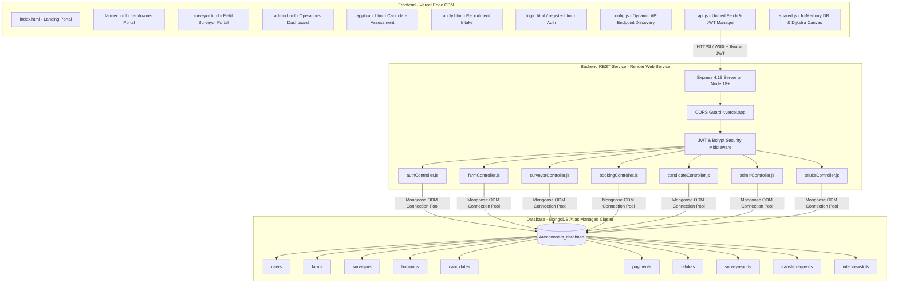
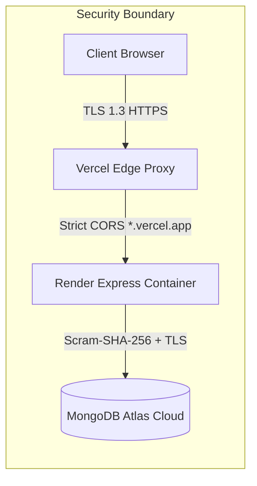

# 🏗️ AgriConnect: System Architecture Document

---

## 1. High-Level Architectural Overview

AgriConnect follows a **Decoupled 3-Tier Cloud Architecture** engineered for high availability, security, and independent scaling.



---

## 2. Layered Architecture Breakdown

### 2.1 Presentation Layer (Frontend on Vercel)
- **Technology**: Pure Semantic HTML5, Vanilla JavaScript (ES6+), Modern CSS3, FontAwesome 6.4, Google Fonts (Outfit & Plus Jakarta Sans).
- **Hosting**: Deployed on **Vercel Edge CDN** (`https://areeeeconect.vercel.app`).
- **Zero Build Dependency**: Pure static architecture requiring no heavy client bundles or Webpack/Vite build steps.
- **Dynamic Config Discovery (`config.js`)**: Automatically detects execution environment (routes to `localhost:5000` in dev, `https://agreeconnect-backend.onrender.com/api` in production) with runtime `localStorage` and `window.AGRICONNECT_API_URL` overrides.
- **Unified API Client (`api.js`)**: Centralized HTTP client managing JWT token injection, automatic header attachment (`Authorization: Bearer <token>`), and structured error wrapping.
- **Client Fallback Engine (`shared.js`)**: Encapsulates in-memory database emulation with localStorage persistence, allowing zero-downtime offline demonstrations.

### 2.2 Application & Business Logic Layer (Backend on Render)
- **Technology**: Node.js (v18+), Express 4.19, Mongoose 8.5, JSON Web Token 9.0, Bcryptjs 2.4.
- **Hosting**: Deployed on **Render Web Service** (`https://agreeconnect-backend.onrender.com`).
- **RESTful API Design**: Strictly modularized across 7 controllers and routers:
  1. `/api/auth`: Registration, login, role evaluation, profile retrieval.
  2. `/api/farms`: Plot demarcation, acreage calculation, soil/terrain pricing.
  3. `/api/surveyors`: Surveyor status toggle, rating updates, resignation handling.
  4. `/api/bookings`: FSM booking lifecycle, manual scheduling, GPS report submission.
  5. `/api/candidates`: Application submission, automated testing (`submit-test`), FIFO promotion.
  6. `/api/admin`: Taluka CRUD, revenue ledger, platform metrics.
  7. `/api/talukas`: Dynamic Taluka capacity feed, surveyor-to-plot assignment.

### 2.3 Data Layer (MongoDB Atlas)
- **Hosting**: Cloud-hosted **MongoDB Atlas M0 Cluster** (`cluster0.0qqka4s.mongodb.net`).
- **Single Source of Truth**: Explicit database binding to `Areeconnect_database`.
- **High Availability**: Multi-region replica sets with connection retry logic and Google/Cloudflare DNS fallback resolution (`8.8.8.8`, `1.1.1.1`).

---

## 3. Dijkstra Geospatial Routing Engine

AgriConnect incorporates an internal graph algorithm engine to model rural transit corridors and compute optimal travel paths between agricultural hubs.

```
                  (15 km)
[Thalner Hub] ─────────────── [Chopda Hub] ──(25 km)── [Yawal Hub] ──(32 km)── [Bhusawal]
     │                             │                                          │
  (22 km)                       (40 km)                                    (28 km)
     │                             │                                          │
[Shirpur Hub] ──(35 km)──► [Sendhwa]                                          │
     │                                                                        │
  (30 km)                                                                     │
     ▼                                                                        ▼
[Amalner Hub] ─────────────────(35 km)─────────────────► [Jalgaon Central Hub] ◄──┘
     │                                                        │
  (40 km)                                                  (30 km)
     │                                                        │
     ▼                                                        ▼
[Pachora Hub] ────────────────────(38 km)──────────────────── [Jamner Hub]
```

### Mathematical Formulation
For a graph $G = (V, E)$ with non-negative edge weights $w(u, v)$ representing physical road distance in kilometers:
$$\text{dist}[v] = \min_{(u,v) \in E} (\text{dist}[u] + w(u, v))$$
- **Priority Queue**: Implemented with indexed minimum distance tracking.
- **Complexity**: $O(|E| + |V| \log |V|)$, resolving optimal multi-hop paths in $< 5\text{ ms}$.

---

## 4. Security & Network Architecture



1. **Authentication & Authorization**:
   - Stateless JWT tokens signed with `HS256` containing `{ userId, role }`.
   - Role-Based Access Control (RBAC) middleware verifying caller permissions before executing privileged actions.
2. **Data & Password Protection**:
   - Passwords hashed using `bcryptjs` with salt round factor 10.
   - Zero password exposure in database queries (`.select('-passwordHash')`).
3. **Log Sanitization**:
   - Custom sanitizer regex intercepts all error logs, masking credentials (`***:***@`) before writing to standard output.
4. **CORS Isolation**:
   - Explicit whitelist restricting API access to `https://*.vercel.app`, local dev origins, and environment-specified `FRONTEND_URL`.
