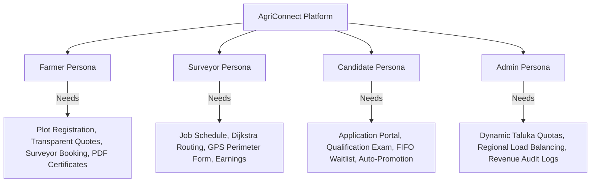

# 🌾 AgriConnect: Product Requirements Document (PRD)

---

## 1. Executive Summary

**AgriConnect** is an enterprise-grade, full-stack digital agricultural land surveying and cadastral management platform. It transforms the traditionally slow, paper-based, and fragmented land measurement process into an automated, transparent, and legally verifiable digital workflow.

The platform connects four key stakeholders:
1. **Farmers (Landowners)**: Who register plots, calculate survey costs, and book certified surveyors.
2. **Surveyors (Field Professionals)**: Who receive bookings, navigate via Dijkstra shortest-path routes, and submit GPS field survey reports.
3. **Candidates (Applicants)**: Qualified engineers/diploma holders who take automated competency exams and enter a FIFO waiting queue for appointment.
4. **Administrators (Operations)**: Who oversee regional Taluka quotas, manage logistics, audit revenue, and ensure platform governance.

---

## 2. Problem Statement

### 2.1 The Traditional Agricultural Surveying Crisis
- **Long Waiting Delays**: Farmers wait between 3 to 8 weeks for physical appointments at Taluka land offices.
- **Unregulated & Opaque Pricing**: Middlemen and unofficial agents charge arbitrary fees without standardized acreage or terrain formulas.
- **Suboptimal Logistics**: Surveyors travel across rural regions without route optimization, leading to high transit costs and delayed inspections.
- **Paper Record Vulnerability**: Physical sketch notes are vulnerable to loss and boundary disputes between adjacent plots.
- **Opaque Surveyor Recruitment**: No transparent mechanism exists to qualify, waitlist, and hire certified surveyors dynamically as regional vacancies arise.

### 2.2 The AgriConnect Solution
- **Instant Digital Booking**: Farmers book certified local surveyors within 60 seconds.
- **Dijkstra Shortest-Path Navigation**: Computes minimum transit distance and road sequences between regional hub nodes.
- **Automated Pricing Engine**: Standardized per-acre calculation with terrain and boundary surcharges.
- **Automated FIFO Recruitment**: 75% test qualification threshold and automatic succession promotion upon surveyor resignation.
- **Cryptographic Digital Certificates**: Immutable land survey certificates with verified GPS perimeter coordinates.

---

## 3. Product Vision & Goals

| Objective | Target Metric | Business Impact |
|---|---|---|
| **Turnaround Time** | Reduce from 21 days to < 48 hours | Accelerates crop insurance, land transfers, and bank collateral loans. |
| **Logistics Efficiency** | 35% reduction in transit distance | Lowers surveyor fuel costs and increases daily completed surveys. |
| **Pricing Transparency** | 100% upfront quote accuracy | Zero hidden charges or middlemen commissions. |
| **Hiring Fairness** | 100% automated FIFO waitlist | Eliminates manual bias in regional surveyor appointments. |
| **Cloud Reliability** | 99.9% uptime | Decoupled Vercel frontend, Render backend, and MongoDB Atlas database. |

---

## 4. User Personas & Stakeholder Analysis

### 4.1 Farmer (Landowner)
- **Profile**: Rural farmer needing boundary demarcation, division, or crop insurance assessment.
- **Core User Journey**: Registers account $\rightarrow$ Registers plot details $\rightarrow$ Gets instant automated cost estimate $\rightarrow$ Books nearest Taluka surveyor $\rightarrow$ Tracks appointment $\rightarrow$ Pays online $\rightarrow$ Downloads verified Certificate.

### 4.2 Surveyor (Certified Field Professional)
- **Profile**: Licensed surveyor with ID `AGR-2026-XXX` assigned to a specific Taluka.
- **Core User Journey**: Logs in with Employee ID/Mobile $\rightarrow$ Reviews assigned bookings $\rightarrow$ Schedules appointment date $\rightarrow$ Navigates to plot using Dijkstra shortest-path route $\rightarrow$ Submits verified GPS report with perimeter coordinates.

### 4.3 Candidate (Applicant Surveyor)
- **Profile**: B.Tech/Diploma/ITI surveying graduate applying for certified surveyor position.
- **Core User Journey**: Submits application with credentials $\rightarrow$ Takes automated online qualification test $\rightarrow$ If Taluka at capacity, enters FIFO waitlist $\rightarrow$ Automatically promoted to active Surveyor with Employee ID upon vacancy.

### 4.4 Administrator (Operations & Revenue)
- **Profile**: Regional director monitoring regional workload, revenue, and compliance.
- **Core User Journey**: Inspects platform dashboard $\rightarrow$ Creates/updates dynamic Talukas $\rightarrow$ Monitors Dijkstra routing network $\rightarrow$ Approves transfers $\rightarrow$ Audits financial transactions.

---

## 5. Functional Requirements by Module

### 5.1 Module 1: Farmer & Plot Demarcation
- **FR-1.1**: Secure user registration (Name, Email, Mobile, Taluka, Village) with bcrypt password hashing.
- **FR-1.2**: Plot registration capturing Gat/Survey Number, Area in Acres, Crop Type, and Terrain Type (Plain, Undulating, Hilly).
- **FR-1.3**: Automatic cost calculation based on acreage base rate + terrain multipliers.
- **FR-1.4**: Booking creation strictly isolated to surveyors belonging to the farmer's Taluka.

### 5.2 Module 2: Surveyor Operations & Booking Lifecycle
- **FR-2.1**: Surveyor dashboard displaying active bookings, completed jobs, and earnings.
- **FR-2.2**: Appointment scheduling with date confirmation.
- **FR-2.3**: GPS field report submission capturing perimeter coordinates, soil condition, boundary markers, and remarks.
- **FR-2.4**: Resignation workflow that automatically triggers FIFO candidate promotion.

### 5.3 Module 3: Dijkstra Logistics Engine
- **FR-3.1**: Graph network linking regional transit nodes (Thalner, Chopda, Shirpur, Amalner, Yawal, Jalgaon, Sendhwa, Bhusawal, Jamner, Pachora).
- **FR-3.2**: Dijkstra shortest path calculation returning minimum distance ($km$), estimated transit duration ($mins$), and hop-by-hop road path.
- **FR-3.3**: Interactive visual canvas displaying graph topology and calculated shortest routes.

### 5.4 Module 4: Candidate Recruitment & FIFO Waitlist
- **FR-4.1**: Candidate portal supporting document submission and qualification verification.
- **FR-4.2**: Automated qualification exam scoring with $\ge 75\%$ passing threshold (`submit-test`).
- **FR-4.3**: FIFO waitlist queue when Taluka capacity (e.g., 3 active surveyors) is reached.
- **FR-4.4**: Instant promotion engine transferring candidate to `User.role = 'surveyor'` upon vacancy.

### 5.5 Module 5: Payments & Certificate Generation
- **FR-5.1**: Integrated payment gateway with unique transaction IDs and invoice generation.
- **FR-5.2**: State machine enforcement preventing payment before survey completion.
- **FR-5.3**: Cryptographic digital land survey certificate generation with unique Certificate ID (`AGR-CERT-XXXXX`) and printable format.

---

## 6. Non-Functional Requirements (NFRs)

- **Security**: JWT Bearer token authentication (HS256), Bcrypt password hashing (salt 10), zero credential exposure in logs, CORS origin isolation.
- **Performance**: Dijkstra path computation $< 5\text{ ms}$; REST API response $< 150\text{ ms}$; page load $< 1.5\text{ s}$.
- **Scalability**: Stateless Express backend horizontally scalable on cloud containers; MongoDB connection pooling with retry loops.
- **Reliability**: Mongoose DNS SRV fallback (`8.8.8.8`, `1.1.1.1`); offline localStorage demo fallback mode.
- **Maintainability**: Centralized environment configuration (`config.js`, `api.js`); separation of concerns across layered architecture.
