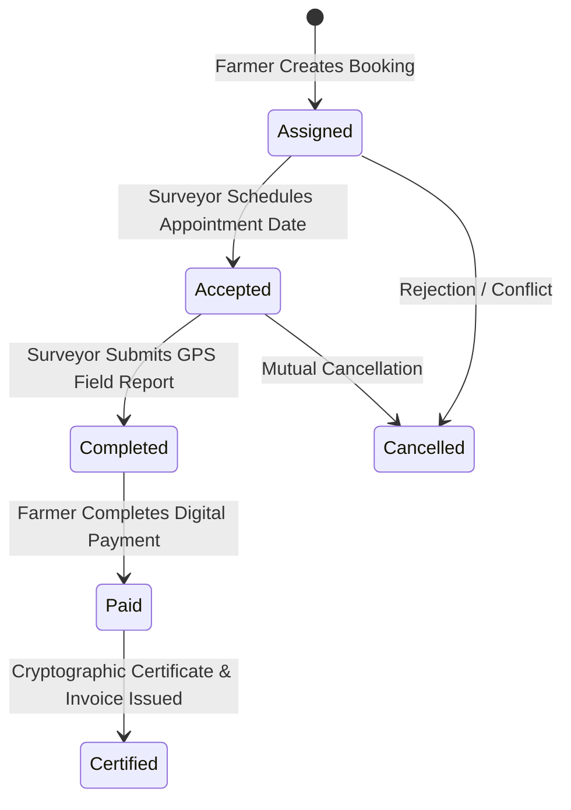
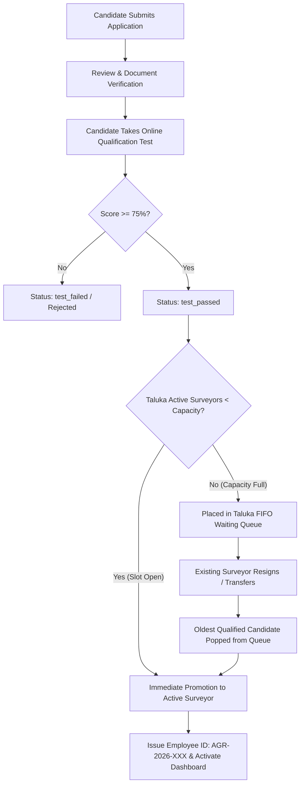

# 📜 AgriConnect: Business Rules & Algorithmic Policies (RULES.md)

---

## 1. Core Platform Rules Matrix

| Rule ID | Rule Category | Scope | Description |
|---|---|---|---|
| **RULE-01** | Geospatial Boundary | Allocation | Farmers can only book surveyors operating within their designated Taluka. Cross-Taluka booking tampering is strictly blocked. |
| **RULE-02** | State Machine | Booking | Bookings must strictly follow the sequential lifecycle: `Assigned` $\rightarrow$ `Accepted` $\rightarrow$ `Completed` $\rightarrow$ `Paid` $\rightarrow$ `Certified`. Skipping states is prohibited. |
| **RULE-03** | Recruitment | Examination | Candidates must achieve a score of $\ge 75\%$ on the automated qualification test to receive `applicationStatus = 'test_passed'`. |
| **RULE-04** | Capacity & Quota | Taluka | Active surveyor count cannot exceed the Taluka's configured capacity (default: 3 active surveyors). |
| **RULE-05** | FIFO Succession | Promotion | When an active surveyor resigns or transfers, the oldest qualified candidate in the Taluka's FIFO waiting queue is automatically promoted. |
| **RULE-06** | Pricing Engine | Calculation | Farm survey charges are calculated strictly on the backend using standardized acreage rates, terrain surcharges, and base certification fees. |
| **RULE-07** | RBAC & Security | Authorization | Non-admin accounts attempting to access `/api/admin/*` receive `403 Forbidden`. Candidate accounts cannot access Surveyor dashboards. |
| **RULE-08** | Certification | Audit | Digital survey certificates (`AGR-CERT-XXXXX`) are issued only after payment verification and GPS perimeter field report submission. |

---

## 2. Rule 01: Taluka Boundary Isolation

1. Every Farmer and Surveyor is registered to an explicit `taluka` (e.g. `chopda`, `thalner`, `shirpur`, `jalgaon`, `jamner`, `pachora`).
2. When a Farmer requests a survey for a registered farm plot, the backend matches only active surveyors where `Surveyor.taluka === Farm.taluka`.
3. Query parameter tampering (e.g., passing `?taluka=shirpur` for a `chopda` farm) is validated and rejected by `bookingController.js`.

---

## 3. Rule 02: Booking Finite State Machine (FSM)

### State Transition Validation Table
| Current State | Target State | Permitted Initiator | Pre-Condition / Validation Guard |
|---|---|---|---|
| `[Initial]` | `Assigned` | Farmer | Farmer selects plot & available Taluka surveyor. `appointmentDate` initialized to `null`. |
| `Assigned` | `Accepted` | Surveyor | Surveyor specifies a valid future `appointmentDate`. |
| `Accepted` | `Completed` | Surveyor | Surveyor submits completed `SurveyReport` with verified GPS coordinates. |
| `Completed` | `Paid` | Farmer | Payment gateway transaction verified; creates unique `Payment` record. |
| `Paid` | `Certified` | System / Auto | Generates unique Certificate ID (`AGR-CERT-XXXXX`) and printable certificate. |
| `Assigned` / `Accepted` | `Cancelled` | Farmer / Admin | Valid cancellation reason recorded; frees surveyor schedule. |

> [!WARNING]
> **Illegal State Jumps Blocked**:
> - A booking in `Assigned` state **cannot** transition directly to `Paid` or `Completed` (HTTP 400 Bad Request).
> - A booking in `Accepted` state **cannot** transition directly to `Paid` without an uploaded `SurveyReport`.

---

## 4. Rule 03 & 04: Candidate Qualification & FIFO Quota Engine

1. **Passing Score Threshold**: Candidates must score $\ge 75\%$ on the technical survey qualification assessment.
2. **Capacity Check**: If $\text{Count}(\text{Active Surveyors in Taluka}) < \text{Taluka Capacity}$, candidate is promoted immediately.
3. **Queue Invariant**: If capacity is full, candidate is placed in `waitingLists[taluka]`. The queue preserves strict First-In, First-Out (FIFO) chronological ordering based on `testSubmittedAt` timestamp.

---

## 5. Rule 05: Resignation & Instant Succession Protocol

When an active surveyor submits a resignation (`POST /api/surveyors/resign`):
1. The resigning surveyor's status is changed to `inactive`, and assigned active bookings are reassigned or closed.
2. The backend queries `waitingLists[taluka]` for the oldest candidate with `applicationStatus: 'test_passed'`.
3. If a candidate exists:
   - Updates `User.role` from `candidate` to `surveyor`.
   - Creates a new `Surveyor` profile with a unique Employee ID: `AGR-2026-XXX`.
   - Updates `Candidate.applicationStatus` to `hired`.
   - Candidate can immediately log in to the Surveyor Dashboard using their original password.

---

## 6. Rule 06: Standardized Pricing Formula

Farm survey charges are deterministically computed on the server side:

$$\text{Total Cost} = \text{Base Fee} + (\text{Area in Acres} \times \text{Per-Acre Rate} \times \text{Terrain Multiplier}) + \text{Certification Surcharge}$$

### Terrain Multipliers
- **Plain Terrain**: $1.0\times$ (No surcharge)
- **Undulating / Semi-Hilly Terrain**: $1.25\times$ (+25% surcharge)
- **Steep / Rocky / Forest Terrain**: $1.50\times$ (+50% surcharge)

---

## 7. Rule 07: Role-Based Access Control (RBAC)

| Role | Permitted Pages / Routes | Restricted Endpoints |
|---|---|---|
| **Farmer** | `farmer.html`, `index.html`, `login.html` | `/api/admin/*`, `/api/surveyors/resign`, `/api/candidates/*` |
| **Surveyor** | `surveyor.html`, `index.html`, `login.html` | `/api/admin/*`, `/api/farms/create` |
| **Candidate** | `applicant.html`, `apply.html` | `surveyor.html` *(Blocked until qualification & promotion)* |
| **Admin** | `admin.html`, all dashboards, all API routes | None *(Superuser privileges)* |
